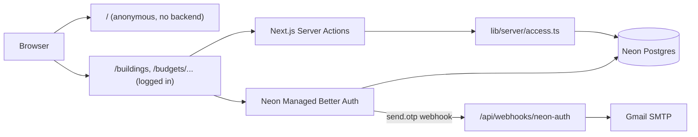

# Backend plan

Status: in progress. Milestone 1 shipped in v0.8.0. Milestone 2 merged. Milestone 3 is in review.

## Goal

Add accounts and saved budgets to Common Charges Calculator. The anonymous calculator stays as it is: paste a `?b=` URL
and work in the browser with no account. An account adds buildings, projects, sharing, drafts, and version history.

Everything runs on free plans if the checks in [Verify before building](#verify-before-building) pass.

## Requirements

- A person logs in with Email OTP. No other login method ships for now.
- A bot cannot make the app send login emails. Cloudflare Turnstile protects login, and the server enforces it.
- A person creates buildings. A building has projects, and a project has budgets.
- A budget has members with a `viewer` or `editor` role.
- A budget can have multiple drafts at once.
- Publishing a draft creates an immutable, numbered version.
- The changelog shows who published each version and when, and what changed between versions.
- File storage is out of scope. Neon Object Storage waits until a feature needs it.

## Terms

| Term           | Meaning                                                                                |
| -------------- | -------------------------------------------------------------------------------------- |
| Account        | One login. Better Auth stores it in the `neon_auth` schema.                            |
| Building admin | The account that created a building. It has full access to everything in the building. |
| Building       | One property.                                                                          |
| Project        | One budget cycle in a building, such as FY2027.                                        |
| Budget         | One scenario in a project, such as "Base case" or "New roof".                          |
| Draft          | A private working copy of a budget. It can change and has one author.                  |
| Version        | A published snapshot of a budget. It never changes.                                    |

"Owner" keeps its current meaning: an entry in `Budget.owners` who owns units and pays charges. An account is never
called an owner, so the two ideas stay separate. An `Owner` does not need an account.

## Architecture



- Next.js on Vercel is the backend. There is no separate service, and all code stays in TypeScript so the server can
  reuse `lib/allocate.ts`, `lib/budget.ts`, and `lib/types.ts`.
- `/` never imports server code, so a Neon outage or an exhausted free tier cannot break the anonymous calculator.
- Neon Functions and Realtime are not used. Next.js already provides server code, and live updates are not a requirement
  because each draft has one author.
- Drizzle defines the schema and generates migrations. Server code connects with `DATABASE_URL`, the pooled connection.
- Every Server Action calls `lib/server/access.ts` before it reads or writes. Pages do not check roles themselves.
- `lib/server/access.ts` returns a grant, such as `BudgetAccess`, and the functions in `lib/server/store.ts` take a
  grant instead of an id. A Server Action that skips the check does not compile.

## Login and bot protection

Managed Better Auth has no captcha plugin. A captcha that only protects our login page is not enough, because a bot can
call Neon's auth endpoint directly and skip the page. Enforcement therefore sits at the step that sends the email.

Subscribing to Neon's `send.otp` webhook turns off built-in delivery, so a code reaches an inbox only if our webhook
sends it.

1. `/login` shows a Turnstile widget and an email field.
2. The `startEmailLogin` Server Action sends the Turnstile token to Cloudflare's `siteverify` endpoint. It checks
   `success`, `hostname`, and `action`.
3. If the checks pass and the throttles allow it, the action writes an `otp_gate` row for the email. The row expires
   after 5 minutes.
4. Neon sends codes only to existing accounts, so the action creates the account first with a random password that
   nobody learns. Neon calls `/api/webhooks/neon-auth` with `user.before_create`, and the webhook allows the account
   only while an `otp_gate` row exists for the email. It does not use up the row.
5. The action asks Neon to send the code. Neon calls `/api/webhooks/neon-auth` with `send.otp`.
6. The webhook verifies Neon's Ed25519 signature and rejects a timestamp older than 5 minutes.
7. The webhook deletes the `otp_gate` row for `user.email` and sends the code. If no valid row exists, it returns 200
   and sends nothing.
8. If Gmail fails, the webhook restores the row and returns 500. Neon then retries, up to 3 attempts.

A bot that calls Neon directly cannot create an account, and gets a code generated but never delivered. The webhook
returns 200 in this case so the response does not show whether the gate passed.

`startEmailLogin` applies these throttles before it writes the row:

- One email per address every 60 seconds.
- Five emails per address every hour.
- A daily limit set below Gmail's limit, so an attack cannot use up the quota silently.

Neon limits wrong code attempts and returns `TOO_MANY_ATTEMPTS`, so the app does not need its own limit on guesses.

Vercel BotID was rejected. Its free Basic mode catches less sophisticated bots and is not a captcha, and it would still
need this same webhook to stop direct calls.

The webhook sends through Gmail SMTP with Nodemailer, from a dedicated Gmail account with an app password. This needs no
domain and costs nothing, but codes can land in spam, so `/login` tells people to check their spam folder.

Other options were rejected:

- Resend likely needs a verified domain, which costs money.
- Email and password as a login method cannot be protected by Turnstile, because no Neon webhook runs before a password
  check. The branch keeps email and password turned on only so the action can create accounts. It requires a verified
  email before a password login, and only a code verifies an email, so a password is never enough without Turnstile.
- Budget passwords with no accounts cannot show reliably who changed a budget.

If Turnstile or Gmail is down, login fails. The anonymous calculator at `/` keeps working.

## Data model

Budget content is stored as `jsonb` in the shape of the existing `Budget` type. Every read passes through
`normalizeBudget`, which already upgrades older budgets.

Separate tables for owners, units, and expenses were rejected. Drafts and versions are whole-budget snapshots, so
separate tables would copy every row on each publish. Nothing needs to query inside a budget from SQL yet.

```sql
create table building (
  id uuid primary key default gen_random_uuid(),
  name text not null,
  admin_id uuid not null, -- neon_auth user id
  created_at timestamptz not null default now()
);

create table project (
  id uuid primary key default gen_random_uuid(),
  building_id uuid not null references building on delete cascade,
  name text not null,
  created_at timestamptz not null default now()
);

create table budget (
  id uuid primary key default gen_random_uuid(),
  project_id uuid not null references project on delete cascade,
  name text not null,
  latest_version integer not null default 0, -- 0 means nothing is published
  created_at timestamptz not null default now()
);

create table budget_member (
  budget_id uuid not null references budget on delete cascade,
  user_id uuid not null,
  role text not null check (role in ('viewer', 'editor')),
  primary key (budget_id, user_id)
);

create table budget_invite (
  id uuid primary key default gen_random_uuid(),
  budget_id uuid not null references budget on delete cascade,
  role text not null check (role in ('viewer', 'editor')),
  token_hash text not null unique,
  created_by uuid not null,
  expires_at timestamptz not null,
  accepted_by uuid,
  accepted_at timestamptz
);

create table budget_draft (
  id uuid primary key default gen_random_uuid(),
  budget_id uuid not null references budget on delete cascade,
  author_id uuid not null,
  name text not null,
  base_version integer not null default 0,
  revision integer not null default 0,
  content jsonb not null,
  updated_at timestamptz not null default now()
);

create table budget_version (
  budget_id uuid not null references budget on delete cascade,
  number integer not null,
  based_on integer not null,
  note text not null default '',
  content jsonb not null,
  published_by uuid not null,
  published_at timestamptz not null default now(),
  primary key (budget_id, number)
);

create table otp_gate (
  email text primary key, -- lowercased, matched against user.email in the webhook
  expires_at timestamptz not null
);

-- One row per email sent. Backs the throttles and the daily limit.
create table otp_send (
  id bigint generated always as identity primary key,
  email text not null,
  sent_at timestamptz not null default now()
);
```

## Permissions

| Action                                        | Viewer | Editor      | Building admin |
| --------------------------------------------- | ------ | ----------- | -------------- |
| See published versions and the changelog      | Yes    | Yes         | Yes            |
| See drafts                                    | No     | Yes         | Yes            |
| Create a draft                                | No     | Yes         | Yes            |
| Edit a draft                                  | No     | Author only | Author only    |
| Publish a draft                               | No     | Author only | Any draft      |
| Delete a draft                                | No     | Author only | Any draft      |
| Manage members and invites                    | No     | No          | Yes            |
| Create, rename, or delete a project or budget | No     | No          | Yes            |
| Delete a building                             | No     | No          | Yes            |

A member can see the name of the building and project that contain a shared budget. A member cannot see other budgets in
that building.

A role is stored only on the budget, as requested. A building admin is not stored in `budget_member`.

## Draft and publish flow

1. An editor creates a draft from the latest version, an older version, or an empty budget. `base_version` records the
   starting point.
2. The author edits the draft. The page saves after a short pause in typing.
3. Each save sends the `revision` the page loaded. A save with an old `revision` is refused, so two open tabs cannot
   silently overwrite each other. The page tells the author to reload.
4. The author publishes the draft with a note. The transaction locks the `budget` row, inserts a `budget_version` with
   `latest_version + 1`, updates `latest_version`, and deletes the draft.
5. If `base_version` is older than `latest_version`, another draft was published first. The author sees a diff against
   the latest version and must confirm before publishing.

A published version replaces the whole budget. Drafts are not merged. To combine two drafts, an author copies the
changes into one draft by hand. Automatic merging is left out because a budget's numbers depend on each other: a clean
merge of two valid drafts can still produce a wrong budget.

To restore an old version, create a draft from it and publish the draft. Version numbers only increase, so the history
stays complete.

The changelog lists `budget_version` rows. A new function, `diffBudgets` in `lib/diff.ts`, compares two snapshots and
reports added, removed, and changed entries. It also compares results from `computeCharges`, so a reader can see how a
change affects each unit.

## Routes

| Route                                   | Purpose                                                     |
| --------------------------------------- | ----------------------------------------------------------- |
| `/`                                     | Anonymous calculator. Adds a "Save to account" button.      |
| `/login`                                | Turnstile and Email OTP.                                    |
| `/api/webhooks/neon-auth`               | Receives Neon's `send.otp` and `user.before_create` hooks.  |
| `/buildings`                            | Buildings the account administers or has shared budgets in. |
| `/buildings/[buildingId]`               | Projects and budgets.                                       |
| `/budgets/[budgetId]`                   | Latest version, drafts, members, and changelog.             |
| `/budgets/[budgetId]/drafts/[draftId]`  | Draft editor.                                               |
| `/budgets/[budgetId]/versions/[number]` | Read-only version.                                          |
| `/invites/[token]`                      | Accepts an invite after login.                              |

"Save to account" keeps the current budget in the browser through login, then creates a new draft from it. The Neon
middleware redirects to `/login` without a return URL, so the button stores the `b` param in `localStorage` and opens
`/buildings`. The logged-in pages show a banner while a budget waits, and a budget page offers to save it there as a new
draft.

## Admin access

The app has no admin page. Use the Neon Console instead: open it from the Vercel dashboard with **Open in Neon**.

- The **Tables** page shows, filters, edits, and exports records.
- The **SQL Editor** runs queries.

Choose the production branch before you look at live data. Edits on this page skip the checks in `lib/server/access.ts`
and can change a published `budget_version`, so treat production edits as repairs only.

Anyone with access to the Neon project can read every budget. The README must say so when it stops saying "Data never
leaves your machine".

## Changes to existing code

`Calculator` in `app/_components/calculator.tsx` owns the budget state. It takes `initialBudget` and calls
`onBudgetChange` with each new budget, including the first. Milestone 4 adds `readOnly`, when the version page needs it.

- `/` passes the budget from `parseBudgetUrl` and keeps the `syncUrlState` behavior.
- The draft editor passes the draft content and saves through `onBudgetChange`.
- The version page will set `readOnly`.
- The `c` and `s` params keep working on every route. Only `/` writes `b`.

Two components write to the URL, so `replaceSearchParams` reads the current URL on each call. A copy from
`useSearchParams` taken during one render would make the second write undo the first.

These text changes ship with accounts:

- `README.md`: replace "Frontend-only" and "Data never leaves your machine". The second statement is already too broad:
  the browser sends `?b=` to Vercel when it loads the page.
- `app/layout.tsx`: update the `description` metadata.

## Deployment

- Production deploys run from tags through `.github/workflows/release.yml`, which is generated, so migrations run from
  `.github/workflows/migrate.yml` on the same tags. That workflow reads a `DATABASE_URL_UNPOOLED` secret from the
  `production` GitHub environment. The two workflows run at the same time, so login can fail for a moment during a
  release that adds a table.
- Migrations must work with the code that is currently deployed, because they run first. Split a rename or a column
  removal across two releases.
- Production uses the Neon resource `neon-bistre-chair`. Preview uses `neon-lime-leaf`, a separate Neon project with its
  own users and data. Connect `neon-lime-leaf` to Development too, so local work has a `DATABASE_URL`.
- Preview builds run migrations on `neon-lime-leaf` through the `vercel-build` script.
- Neon keeps preview branches until Vercel removes the preview deployment, 6 months by default. Delete old branches so
  they do not use up the free plan.
- Neon configures webhooks per branch. To test Gmail in Preview, add the `send.otp` webhook to the main branch of
  `neon-lime-leaf`, pointing at a stable preview URL. A new branch has no webhook and uses Neon's built-in email.
  Preview builds use Cloudflare's Turnstile test keys.
- Preview and Development can read the real Gmail app password, because Gmail sending is tested there. Anyone who can
  deploy to this project can read it, so keep that list to people you trust.

## Testing

Follow the current style: few mocks, with tests that check real behavior.

- Vitest covers `diffBudgets` as pure functions.
- `lib/server` tests run real SQL against PGlite, an in-process Postgres. They cover each row of the permissions table,
  stale `revision` refusal, publish numbering, and the gate: no row means no email, and a row works once.
- Webhook tests sign requests with a test Ed25519 key and cover a bad signature and an old timestamp.
- The primary key on `budget_version` is the final guard against two publishes taking the same number.

## Milestones

Each milestone can ship alone.

1. **Login.** Add Drizzle, migrations, the deploy steps, Email OTP, Turnstile, the `send.otp` webhook, and a logged-in
   `/buildings` page with a log out button. Login does not go live without the gate.
2. **Calculator split.** Extract `Calculator`. No behavior change.
3. **Buildings and drafts.** Create buildings, projects, and budgets. Add "Save to account" and autosaved drafts.
4. **Versions.** Publish, read-only versions with a `readOnly` prop on `Calculator`, restore, and the changelog with
   `diffBudgets`. The `neon-http` driver in `getDb` has no transactions, so publish needs the WebSocket driver from
   `@neondatabase/serverless`.
5. **Sharing.** Roles, invite links, and permission checks for members.

Until milestone 5 ships, only the building admin can reach a budget.

## Verify before building

- [x] The Neon project shows the free plan through the Vercel integration. Vercel lists the installation as `Free`.
- [x] `NEON_AUTH_BASE_URL` is set in the Vercel project for Production and Preview. This shows Managed Better Auth is
  on.
- [ ] Confirm the current server API in `@neon/auth`. The package was renamed, and some Neon docs use the old name.
- [x] Send one real login for a person who has no account yet. Neon generated a code but did not call `send.otp`, so the
  action now creates the account first, gated by `user.before_create`.
- [x] Confirm that `user.before_create` sends `user.email`, and that a first-time login works end to end. Verified on
  the preview: the account was created, one code was sent through Gmail, and the login verified the email.
- [ ] Confirm the Neon Console shows the Tables page on this plan, and whether it shows the `neon_auth` schema.
- [ ] Confirm Gmail's daily send limit, then set the daily limit below it.
- [ ] Send test codes to Gmail, Outlook, and Yahoo addresses and check that they reach the inbox.
- [x] Confirm the `siteverify` fields in Cloudflare's own docs. The response includes `success`, `hostname`, and
  `action`. A token works once, expires after 300 seconds, and has at most 2048 characters.
- [ ] Confirm Turnstile's free limits in Cloudflare's own docs. Third-party sources disagree.
- [ ] Measure the size of a real budget as JSON. The 1 GB limit holds about 20,000 snapshots if one is 50 KB. That size
  is an assumption.

## Setup you do by hand

1. Enable Managed Better Auth in the Neon integration. On each branch, turn on email and password with "require email
   verification", and remove the shared Google provider. Add `NEON_AUTH_COOKIE_SECRET` to the Vercel project, with a
   different random value of at least 32 characters for each environment.
2. Create a free Cloudflare account and a Turnstile widget for the production hostname.
3. Add the keys to the `common-charges-calculator` Vercel project. Add `CLOUDFLARE_TURNSTILE_SITE_KEY` and
   `CLOUDFLARE_TURNSTILE_SECRET_KEY`, with the real keys for Production and Cloudflare's test keys for Preview and
   Development. Mark the production secret key as sensitive. Do not paste it into a chat. `/login` is a Server Component
   that reads the site key and passes it to the widget as a prop.
4. Create a dedicated Gmail account, turn on 2-step verification, and create an app password. Add the address as
   `GMAIL_USER` and the app password as `GMAIL_APP_PASSWORD` in the Vercel project, for all environments so Gmail
   sending can be tested in Preview and Development, marked as sensitive. Do not commit the app password or paste it
   into a chat.
5. Add the production webhook in Neon for `send.otp` and `user.before_create`, pointing at `/api/webhooks/neon-auth`,
   with a 10-second timeout. Do this when the release ships, because email and password stay off in production until the
   webhook can refuse sign-ups.
6. Add the production domain to trusted domains, and disable "Allow Localhost" in production.

## Open questions

1. **Should invites go by email?** This plan assumes no. A building admin creates a link and sends it themselves, which
   avoids an email provider. Links expire after 7 days and work once.
2. **Should other editors see a draft?** This plan assumes yes, read-only. The alternative is that a draft stays visible
   only to its author and the building admin.
3. **What should deleting do?** This plan assumes a hard delete with a typed confirmation. A deleted building cannot be
   restored by the app, and its version history goes with it.
4. **Should a budget be able to copy from another?** Decided: yes, in milestone 3. A new budget can start as a copy of
   another budget in the same building. Until versions exist, the copy takes that budget's newest draft. After milestone
   4 it should take the latest version.
